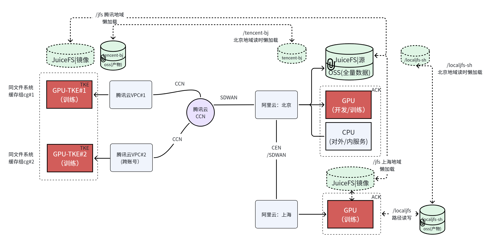
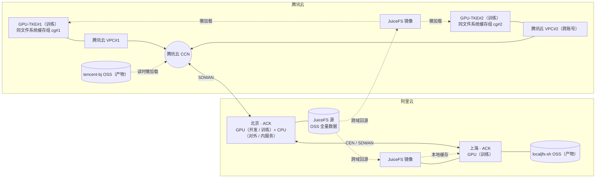

# 多云 / 多地域架构（Multi-Region Architecture）

本项目用于沉淀一套 **跨腾讯云与阿里云的多地域 AI 基础设施架构设计**：以 JuiceFS 为统一文件系统，把「全量数据的单一可信源」与「各训练/推理地域的按需镜像」分层组织起来，在跨云、跨地域之间实现一份数据多处消费、按需加载、就近读写。

仓库当前以架构图为主要交付物，本文档是对图中各组件的文字化说明，便于评审、落地和后续扩展。

## 架构图



> 图中的 `architeture.png` 为原始文件名，为保证已有链接与引用不失效而保留。

## 设计目标

从架构图可以归纳出四条主线：

| 目标 | 实现方式 |
| --- | --- |
| **一份数据、多地训练** | 阿里云北京持有 JuiceFS 源（OSS 全量数据），其余地域只部署镜像集群 |
| **按需取数，控制跨域成本** | 镜像集群采用懒加载 / 读时懒加载，首次读回源、后续命中缓存 |
| **跨云跨域互联** | 腾讯云内用 CCN 打通 VPC，跨云用 SDWAN，阿里云内用 CEN / SDWAN |
| **计算按职能分层** | GPU 集群承担训练与开发，CPU 集群承担对外/内服务 |

## 逻辑拓扑



## 组件说明

| 组件 | 归属 | 职责 |
| --- | --- | --- |
| **GPU-TKE#1 / GPU-TKE#2** | 腾讯云 TKE | GPU 训练集群，二者分别挂载在同一文件系统的缓存组 `cg#1`、`cg#2` 下 |
| **腾讯云 VPC#1** | 腾讯云 | 承载 `GPU-TKE#1` 的训练网络 |
| **腾讯云 VPC#2（跨账号）** | 腾讯云 | 跨账号 VPC，承载 `GPU-TKE#2`，用于账号隔离 / 多团队接入 |
| **腾讯云 CCN** | 腾讯云 | 云联网，收敛各 VPC 流量，并作为跨云出口 |
| **SDWAN** | 跨云链路 | 腾讯云 CCN ↔ 阿里云北京 的专线 / 加密互联 |
| **阿里云：北京** | 阿里云 | 核心地域：GPU（开发 / 训练）+ CPU（对外 / 内服务），并持有 JuiceFS 源 |
| **阿里云：上海** | 阿里云 | 训练地域：ACK GPU 训练集群，就近消费镜像数据 |
| **CEN / SDWAN** | 阿里云内 | 北京 ↔ 上海 的云企业网互联 |
| **JuiceFS 源（OSS 全量数据）** | 阿里云北京 | 唯一可信数据源，承载全量数据集 |
| **JuiceFS 镜像（腾讯地域 / 上海地域）** | 腾讯云、阿里云上海 | 源数据的只读镜像，按需回源、本地缓存 |
| **tencent-bj OSS（产物）** | 腾讯云北京 | 腾讯侧训练产物（模型 / checkpoint 等）落盘 |
| **localjfs-sh OSS（产物）** | 阿里云上海 | 上海侧通过 `/localjfs` 路径写入的训练产物 |
| **同文件系统缓存组 cg#1 / cg#2** | 腾讯云 TKE | 同一文件系统下按集群划分的缓存组，避免多集群争抢同一缓存配额 |

## 数据分层与缓存策略

架构把数据分成 **源** 与 **镜像** 两层：

1. **源层（Source）**：仅阿里云北京一处，全量数据存放于 OSS，由 JuiceFS 源集群对外提供一致性视图。
2. **镜像层（Mirror）**：腾讯地域与上海地域各部署镜像集群，挂载点分别为 `/jfs`（腾讯）与 `/localjfs`（上海）。
3. **懒加载**：镜像启动时不复制全量数据，首次访问某个文件时才触发回源拉取；此后命中本地缓存，跨域带宽只与「实际被读到的数据量」相关。
4. **读时懒加载**：对 `tencent-bj`、`localjfs-sh` 等产物桶，同样采用读时按需加载——北京地域在需要时才把远端产物拉回本地，而不是预先同步。
5. **产物写路径**：训练产物写本地 OSS（`/localjfs` → `localjfs-sh`），与源数据分离，避免污染只读镜像。

这种分层的收益是把「数据放置」从「按地域全量复制」变成「按访问热度动态填充」，代价是首次访问存在回源延迟，因此需要配合缓存预热与容量水位监控。

## 典型数据流

**训练读取（跨云）**

```
GPU-TKE#1/#2 ──> VPC ──> CCN ──SDWAN──> 阿里云北京 JuiceFS 源(OSS 全量)
      └── 未命中时经 JuiceFS 镜像按需回源，命中后本地缓存
```

**训练读取（阿里云内）**

```
阿里云上海 GPU ──> JuiceFS 镜像(/localjfs) ──未命中──> CEN/SDWAN ──> 北京 JuiceFS 源
```

**产物落盘**

```
腾讯侧训练 ──> tencent-bj OSS（产物，读时懒加载消费）
阿里云上海训练 ──> /localjfs ──> localjfs-sh OSS（产物）
```

## 网络互联要点

- **云内**：腾讯云用 CCN 把 VPC#1、VPC#2 收敛到同一张网；阿里云用 CEN 打通北京与上海。
- **跨云**：CCN ↔ 阿里云北京 走 SDWAN，仅暴露必要的 JuiceFS 元数据 / 数据端口。
- **账号隔离**：VPC#2 为跨账号 VPC，说明架构支持多账号（多团队 / 多业务线）接入同一套数据平面。
- **流量路径**：训练流量优先走云内链路，跨云只在数据未命中时发生，避免常态化的跨云大流量。

## 目录结构

```
multi-region-architecture/
├── README.md          # 本文档
└── architeture.png    # 架构图（原始文件名保留）
```

## 术语表

| 缩写 | 全称 | 说明 |
| --- | --- | --- |
| TKE | Tencent Kubernetes Engine | 腾讯云容器服务 |
| ACK | Alibaba Cloud Container Service for Kubernetes | 阿里云容器服务 |
| VPC | Virtual Private Cloud | 私有网络 |
| CCN | Cloud Connect Network | 腾讯云云联网 |
| CEN | Cloud Enterprise Network | 阿里云云企业网 |
| SDWAN | Software-Defined WAN | 软件定义广域网，跨云 / 跨地域专线互联 |
| JuiceFS | — | 基于对象存储的分布式文件系统，支持多客户端共享与缓存 |
| OSS | Object Storage Service | 对象存储（阿里云 / 腾讯云均用此名） |
| cg | cache group | JuiceFS 缓存组，用于隔离同一文件系统下不同集群的本地缓存 |

## 后续可补充

- [ ] 各组件规格与容量规划（GPU 卡型、节点数、缓存盘大小）
- [ ] JuiceFS 元数据引擎选型与高可用方案
- [ ] 缓存预热策略与命中率 / 回源带宽监控指标
- [ ] 跨云链路 SLA、故障切换与降级预案
- [ ] 以 IaC（Terraform / Pulumi）固化网络与集群编排

## License

仓库暂未声明开源许可证；如需对外复用，请先补充 `LICENSE`。
